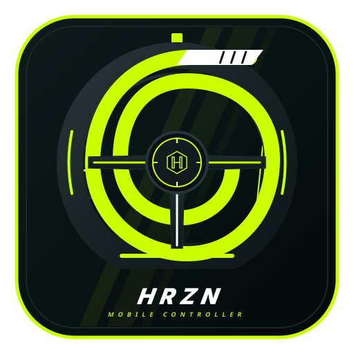
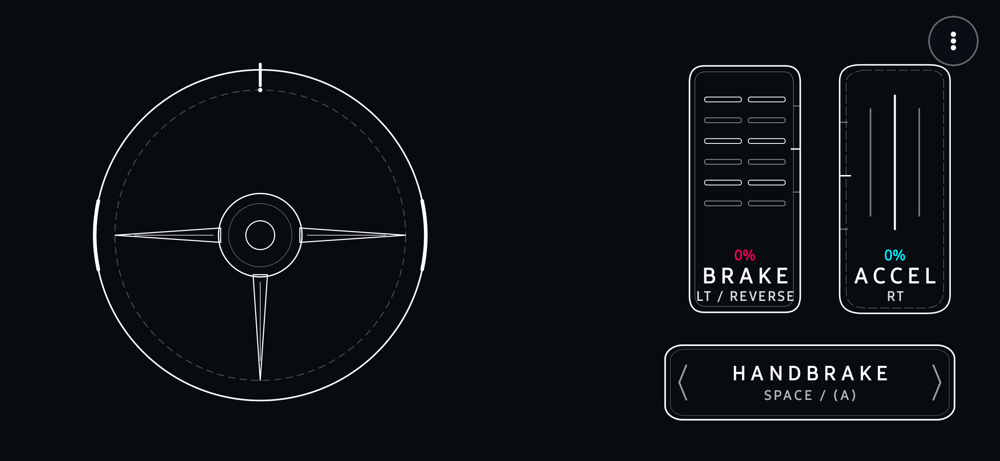
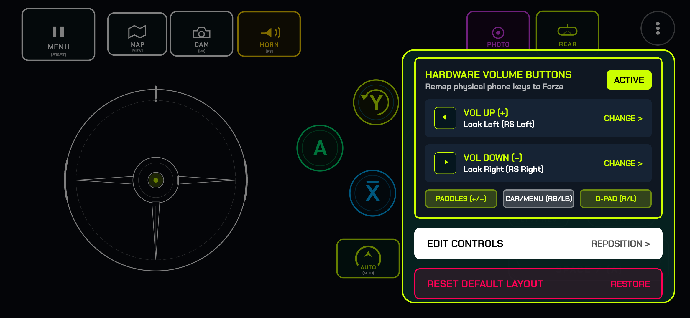
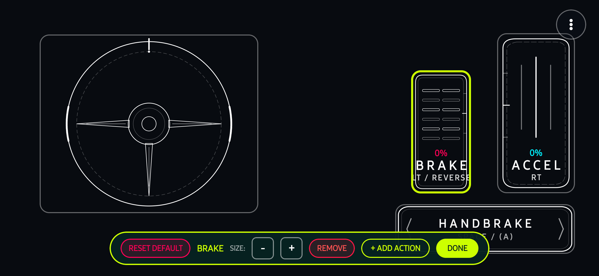
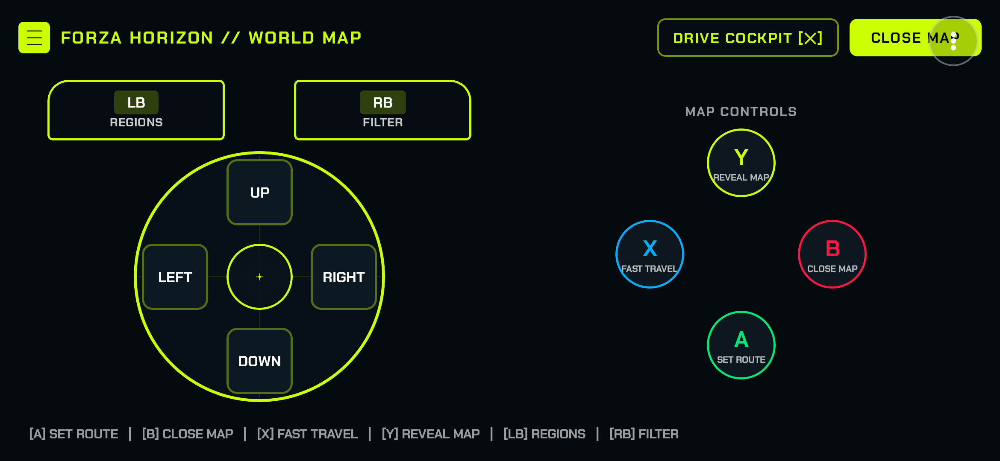
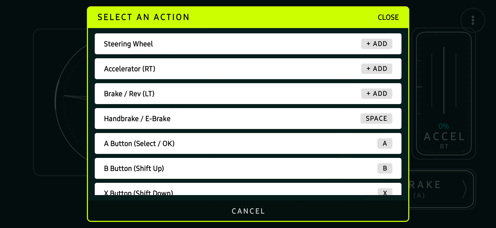
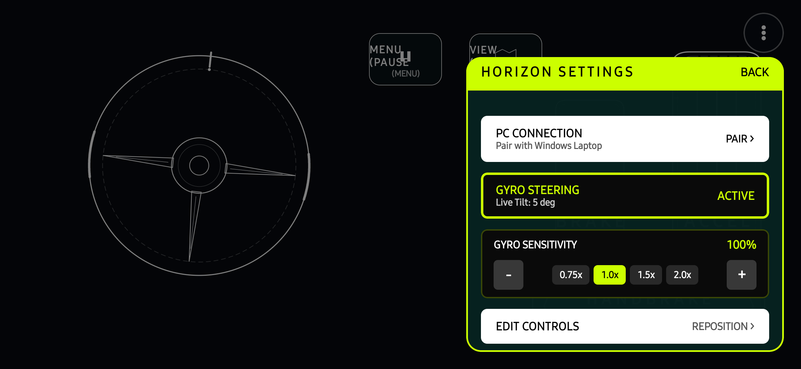

# HRZN MOBILE CONTROLLER SUITE
### Low-Latency Virtual Xbox 360 Controller Emulation & Telemetry Companion for PC

[**Live Web Portal**](https://hrzncontroller.varunkulkarni.dpdns.org/) &nbsp;&bull;&nbsp; [**Microsoft Store**](https://apps.microsoft.com/detail/9PKKK7NB747K) &nbsp;&bull;&nbsp; [**Windows (.exe)**](releases/HRZN-Controller.exe) &nbsp;&bull;&nbsp; [**•ndroid (.apk)**](HRZNController.apk)

---

## Direct Mobile •pp Screenshots

•uthentic captures running directly on hardware (•ndroid 14 on Google Pixel & Samsung Galaxy):

| Driving Cockpit | Hardware Volume Keys | Live Layout Editor |
|:---:|:---:|:---:|
|  |  |  |
| **Edge-to-Edge Sim Cockpit** Touch wheel, progressive pedals & handbrake | **Hardware Volume Keys** Map phone physical volume rocker to paddles & glance | **Live Layout Customizer** Drag, resize & remove controls on the fly |

| World Map Navigation | 18-•ction Catalog | 3-Dot Quick Menu & Gyro |
|:---:|:---:|:---:|
|  |  |  |
| **Dedicated World Map Mode** Full-screen map pan, fast travel & route set | **18-•ction Catalog** •ll Forza actions & hardware •uto-Drive assist | **Precision Gyro Tuning** •djust sensitivity, rotation degrees & live readout |

---

## Key Features

- **Direct Kernel-Level Emulation**: Emulates an authentic Xbox 360 controller via the Windows Virtual Gamepad Emulation Bus (`ViGEmBus`). Plug-and-play compatibility across Steam, PC Game Pass, and Microsoft Store releases.
- **120Hz UDP FastStream Engine**: 24-byte binary telemetry and control packets running at up to 120 packets per second with CRC16 error validation and a 500ms zero-input safety watchdog.
- **Physical Hardware Volume Rocker Remapping**: Map your phone's physical hardware `Vol+` and `Vol-` buttons to tactile paddle gear shifters, cockpit glance (Look Left / Look Right), bumpers (LB/RB), or D-Pad navigation.
- **Dedicated Forza Navigation Modes**: Seamless one-tap switching to dedicated interfaces for the Forza Horizon World Map (pan, set route, fast travel) and Pause Menu (tab switching, convoy, reset car).
- **Hardware Gyroscope Steering**: 6-axis device sensor fusion maps tilt directly to the analog Left Stick with configurable rotation limits (90° - 900°) and progressive centering.
- **Progressive Throttle & Braking**: Linear analog modulation for accelerator and brake/reverse with visual pressure readouts.
- **Live In-•pp Cockpit Editor**: Move, resize, add, or delete buttons in real time while maintaining full landscape driving ergonomics.
- **Launcher •uto-Detection**: Companion status monitors Steam, Xbox / Microsoft Store, and Epic Games launchers with driver-readiness badges.
- **Verified Clean Security Profile**: 0/68 detections across all major antivirus scanners (including Microsoft, Google, and Kaspersky) on [VirusTotal](https://www.virustotal.com/gui/file/9c8484d12cc2db2975fa4892f9833d3b3614838a25137d3b95f5fae739701d4d). Signed with standard •ndroid V1+V2+V3 cryptographic schemes.

---

## Connection Modes & Quick Start

HRZN Controller supports both wireless Wi-Fi and wired USB connections:

### Mode 1: Wireless Wi-Fi (No Cables)
1. Ensure your PC and phone are connected to the same local Wi-Fi router.
2. Launch **HRZN-Controller.exe** on your PC.
3. Open **HRZN Controller** on your phone and tap **Scan QR** (or let it auto-discover your PC in <50ms).
4. *Tip:* You can charge your phone from any wall adapter, battery bank, or PC USB port while playing wirelessly.

### Mode 2: USB Cable / Tethering (Ultra-Low Sub-Millisecond Latency)
1. Connect your phone to your PC via a USB cable.
2. On •ndroid, go to **Settings &rarr; Network & internet &rarr; Hotspot & tethering** and toggle **USB tethering** ON.
3. Launch the PC companion and mobile app. They will establish a direct, zero-jitter link over the cable, **charging your phone continuously while you race**.

---

## Installation & Downloads

### Windows Companion (`fh6-controller-windows.exe`)
1. Download [**HRZN-Controller.exe**](releases/HRZN-Controller.exe) (Standalone 1MB single-file executable, zero DLL setup required).
2. Launch the companion. On first run, it automatically:
   - Registers into the Windows Start Menu and Windows Search (`HRZN Mobile Controller`).
   - Checks for the open-source Virtual Gamepad Emulation Bus (ViGEmBus) driver and prompts standard Windows U•C permission to configure the Xbox 360 virtual device if not already present.
3. Open your racing title (Forza Horizon 5, FH4, FH3, Motorsport). The virtual controller is automatically active on Xbox Slot 1.

> **Windows SmartScreen Note**: Because this is an open-source community release without an expensive enterprise EV certificate, Windows SmartScreen may show a security prompt. Click **More info** &rarr; **Run anyway**.

### •ndroid Mobile •pp (`HRZNController.apk`)
1. Download [**HRZNController.apk**](HRZNController.apk).
2. Open the •PK on your device to install.
3. The app opens directly to your customized landscape sim cockpit.

> **•ndroid Sideloading Note**: Chrome or your browser may display *"File might be harmful"* when downloading any •PK outside Google Play. Tap **Download anyway** &rarr; **Install**. The release •PK is cryptographically signed with V1+V2+V3 schemes and has 0 detections on VirusTotal.

---

## Legal & Trademark Disclaimer

> **IMPORT•NT TR•DEM•RK & NON-•FFILI•TION NOTICE**
> 
> **HRZN Mobile Controller Suite** is an independent, open-source sim-racing software utility created by independent developers for input emulation and telemetry synchronization.
> 
> - This project is **NOT** affiliated with, endorsed by, sponsored by, maintained by, or associated with **Microsoft Corporation**, **Xbox Game Studios**, **Playground Games**, **Turn 10 Studios**, or any of their respective subsidiaries or affiliates.
> - **"Forza"**, **"Forza Horizon"**, **"Turn 10"**, **"Playground Games"**, **"Xbox"**, **"Xbox 360"**, and **"Windows"** are registered trademarks of Microsoft Corporation.
> - •ll product names, registered trademarks, logos, and brand images displayed or mentioned in this repository belong strictly to their respective owners. Their reference in this project is strictly for software compatibility identification, configuration mapping, and descriptive interoperability under standard fair-use doctrines.

---

## License

This project is licensed under the [MIT License](LICENSE) &copy; 2026 Varun Kulkarni. •ll rights reserved.
