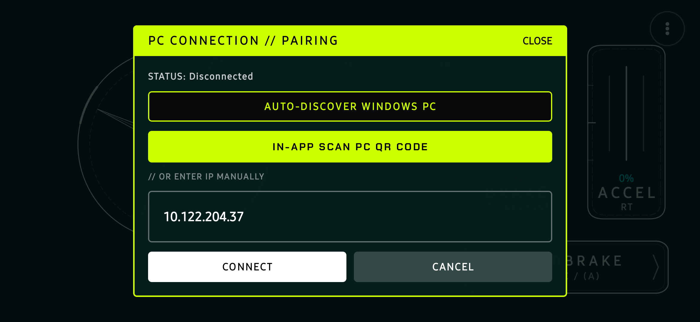

# FORZA HORIZON CONTROLLER SUITE
### Low-Latency Virtual Xbox 360 Controller Emulation & Telemetry Companion for PC

[**Live Web Portal**](https://horizoncontro.varunkulkarni.dpdns.org/) &nbsp;&bull;&nbsp; [**Microsoft Store**](https://apps.microsoft.com/detail/9PKKK7NB747K) &nbsp;&bull;&nbsp; [**Windows (.exe)**](releases/fh6-controller-windows.exe) &nbsp;&bull;&nbsp; [**Android (.apk)**](HorizonController.apk)

---

## Direct Mobile App Screenshots

Authentic captures running directly on hardware (Android 14 on Google Pixel & Samsung Galaxy):

| Driving Cockpit | Live Layout Editor | Forza Action Catalog |
|:---:|:---:|:---:|
|  |  |  |
| **Edge-to-Edge Sim Cockpit** Touch wheel, progressive pedals & handbrake | **Live Layout Customizer** Drag, resize & remove controls on the fly | **18-Action Catalog** All Forza actions & hardware Auto-Drive assist |

| 3-Dot Quick Menu & Gyro Readout | Instant QR Scanner & LAN Pairing |
|:---:|:---:|
|  |  |
| **Precision Gyro Tuning** Adjust sensitivity, rotation degrees & live readout | **Zero-Config LAN Pairing** Scan QR code or auto-discover PC in <50ms |

---

## Key Features

- **Direct Kernel-Level Emulation**: Emulates an authentic Xbox 360 controller via the Windows Virtual Gamepad Emulation Bus (`ViGEmBus`). Plug-and-play compatibility across Steam, PC Game Pass, and Microsoft Store releases.
- **120Hz UDP FastStream Engine**: 24-byte binary telemetry and control packets running at up to 120 packets per second with CRC16 error validation and a 500ms zero-input safety watchdog.
- **Hardware Gyroscope Steering**: 6-axis device sensor fusion maps tilt directly to the analog Left Stick with configurable rotation limits (90° - 900°) and progressive centering.
- **Progressive Throttle & Braking**: Linear analog modulation for accelerator and brake/reverse with visual pressure readouts.
- **Live In-App Cockpit Editor**: Move, resize, add, or delete buttons in real time while maintaining full landscape driving ergonomics.
- **Launcher Auto-Detection**: Companion status monitors Steam, Xbox / Microsoft Store, and Epic Games launchers with driver-readiness badges.
- **Start Menu & Windows Search Integration**: Registers natively into the Windows Start Menu, Windows Search indexing, and Settings Installed Apps.

---

## Quick Start & Installation

### Windows Companion (`fh6-controller-windows.exe`)
1. Download [**fh6-controller-windows.exe**](releases/fh6-controller-windows.exe) (or run [Install-Windows-App.bat](releases/Install-Windows-App.bat) for 1-click install).
2. Launch the companion. On first run, it automatically:
   - Registers into the Windows Start Menu and Windows Search (`Forza Horizon Controller`).
   - Checks for the kernel `ViGEmBus` driver and installs it silently if missing.
3. Open your racing title (Forza Horizon 5, FH4, FH3, Motorsport). The virtual controller is automatically active on Xbox Slot 1.

> **Windows SmartScreen Note**: Because this is an open-source community release without a commercial EV certificate, Windows SmartScreen may show a security prompt. Click **More info** &rarr; **Run anyway**.

### Android Mobile App (`fh6-controller-android.apk`)
1. Download [**fh6-controller-android.apk**](releases/fh6-controller-android.apk).
2. Open the APK on your device to install.
3. Ensure your phone and PC are connected to the same Wi-Fi network, or connect via USB Tethering for 0ms jitter.
4. Launch the app and tap **Scan QR** on the PC companion screen to pair instantly.

> **Android Sideloading Note**: Chrome or your browser may display *"File might be harmful"* when downloading any APK outside Google Play. Tap **Download anyway** &rarr; **Install**. The release APK is cryptographically signed with V1+V2 signatures and zero debug flags.

---

## Legal & Trademark Disclaimer

> **IMPORTANT TRADEMARK & NON-AFFILIATION NOTICE**
> 
> **Forza Horizon Controller Suite** is an independent, open-source sim-racing software utility created by independent developers for input emulation and telemetry synchronization.
> 
> - This project is **NOT** affiliated with, endorsed by, sponsored by, maintained by, or associated with **Microsoft Corporation**, **Xbox Game Studios**, **Playground Games**, **Turn 10 Studios**, or any of their respective subsidiaries or affiliates.
> - **"Forza"**, **"Forza Horizon"**, **"Turn 10"**, **"Playground Games"**, **"Xbox"**, **"Xbox 360"**, and **"Windows"** are registered trademarks of Microsoft Corporation.
> - All product names, registered trademarks, logos, and brand images displayed or mentioned in this repository belong strictly to their respective owners. Their reference in this project is strictly for software compatibility identification, configuration mapping, and descriptive interoperability under standard fair-use doctrines.

---

## License

This project is licensed under the [MIT License](LICENSE) &copy; 2026 Varun Kulkarni. All rights reserved.
